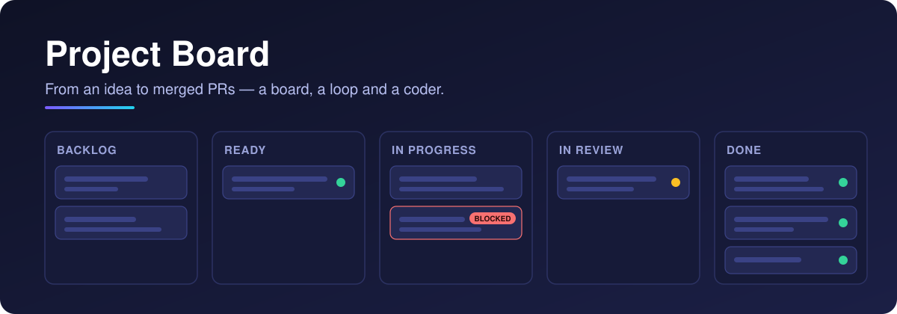

<p align="center">
  
</p>

<p align="center">
  <a href="https://github.com/protoLabsAI/projectBoard-plugin/actions/workflows/ci.yml"></a>
  <a href="https://github.com/protoLabsAI/projectBoard-plugin/releases/latest"></a>
  <a href="https://github.com/protoLabsAI/protoAgent"></a>
  
  <a href="https://github.com/Dicklesworthstone/beads_rust"></a>
</p>

# Project Board

A **protoAgent plugin** that turns an idea into merged PRs. A lean board backed by
[beads-rust](https://github.com/Dicklesworthstone/beads_rust) (`br`), a loop that hands each card to a
coding agent in its own git worktree, an adversarial planning layer, and a Kanban console view.
Install it into any protoAgent agent from this git URL.

```
backlog → ready → in_progress → in_review → done
                      │
                      └── blocked  (a flag, not a lane)
```

## What you get

- **A board that can't drift.** Cards are a projection over beads, so the work graph has one source of truth.
- **A loop that ships.** It takes the top `ready` card, builds it in a disposable worktree, runs the gate, opens the PR, and moves the card to `done` when it merges.
- **Gates at each edge.** A Ready gate on the way in, a fast local gate before the PR, then CI, a review gate and (opt-in) auto-merge.
- **Self-healing.** Transient failures retry, capability failures can climb to a stronger model, and a restart recovers cards stranded mid-build.
- **Planning built in.** Skills turn an idea into epics and cards, onboard a new repo, and learn from past failures.

## Quick start

```bash
python -m server plugin install https://github.com/protoLabsAI/projectBoard-plugin --ref main
```

Installing doesn't enable it. Turn it on in **Settings → Plugins → Project Board**; it hot-mounts, no restart.
Then point it at a repo and a coder:

```yaml
# config/langgraph-config.yaml
plugins:
  enabled: [delegates, project_board]

delegates:
  - { name: proto, type: acp, command: proto, args: ["--acp"], workdir: ~/dev/my-repo, permissions: allowlist }

project_board:
  coder: proto           # required: the ACP delegate the loop dispatches to
  repo: ~/dev/my-repo
  loop_enabled: true     # start the background puller
```

You need `git`, an authenticated `gh`, and an ACP coder. `br` is fetched for you on first run.
The board checks all of this itself and says what's missing instead of booting green
([requirements and install](docs/install.md)).

## Using it

| To | Do this |
|---|---|
| Add work | `board_create_feature` (title, spec, acceptance criteria, `files_to_modify`), then `board_mark_ready` |
| See the board | The **Board** view in the console's left rail, or `board_list` |
| Plan a project | Ask for the `decompose-project` skill: "decompose \<idea\>" |
| Onboard a repo | The `onboard-project` skill, before pointing the board at a new repo |
| Learn from failures | The `loop-retro` skill |

More in [Using the board](docs/usage.md).

## Documentation

| Doc | What's in it |
|---|---|
| [Requirements and install](docs/install.md) | What you need, install, enable |
| [Annotated configuration](docs/annotated-config.md) | A commented `project_board:` block and where the board lives |
| [How it works](docs/overview.md) | The store, the loop, escalation, `coder.solve()`, the planning layer |
| [Using the board](docs/usage.md) | Tools, skills, the HTTP surface, the console view |
| [Lifecycle](docs/lifecycle.md) | The lanes, the `in_review` sub-states, blocked-card self-heal |
| [The gate](docs/gate.md) | The fast local gate, `auto` discovery, preflight, environment |
| [Setup preflight](docs/setup-preflight.md) | "Can the board run at all?", and the first-run `br` fetch |
| [The task lane](docs/task-lane.md) | Cards that ship a deliverable instead of a PR |
| [Publish gates](docs/publish-gates.md) | Cross-repo chains: waiting on an npm version or a release |
| [Console settings](docs/console-settings.md) | The fields you can edit in the UI |
| [Configuration reference](docs/configuration.md) | Every key, its default, and live / reload / restart |
| [Tools](docs/tools.md) · [HTTP API](docs/api.md) | Every agent tool and route |
| [Decision records](docs/adr/) | This plugin's own ADRs |
| [Development](docs/development.md) | Layout, test seams, scripts, releasing |

A working example host is **[roxy](https://github.com/protoLabsAI/roxy)**: it installs this plugin as
its coding-orchestration layer and shows the wiring end to end.
